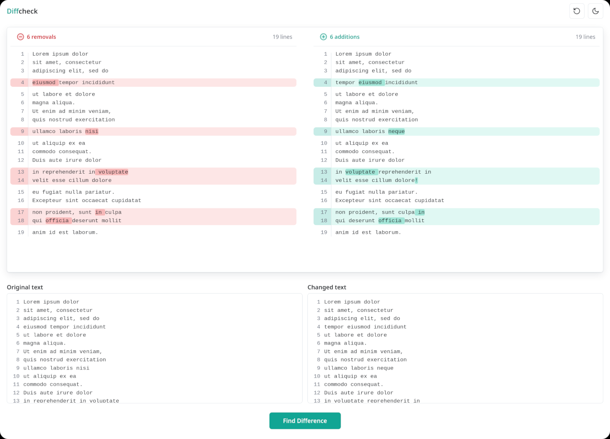

# diffcheck
Simple self-hostable text diff checker. The comparison runs entirely in the browser;
the server only serves five static files and the `diff` (jsdiff) browser bundle.



## Run

    npm install      # commit the generated package-lock.json, then use `npm ci` in deployments
    npm start        # http://127.0.0.1:3000

Environment: `HOST` (default `127.0.0.1`; use `0.0.0.0` in containers), `PORT` (default `3000`).
Shortcut: Ctrl/Cmd+Enter in either field runs the comparison.

## Docker

``` sh
docker run -p 127.0.0.1:10300:10300 tannisroot/diffcheck:latest
```

## LLM usage notice

This was entirely vibe-coded with Claude Sonnet 5.5 at Medium due to lack of decent, simple self-hosted alternatives to diffchecker.com.
Use at your own peril!
